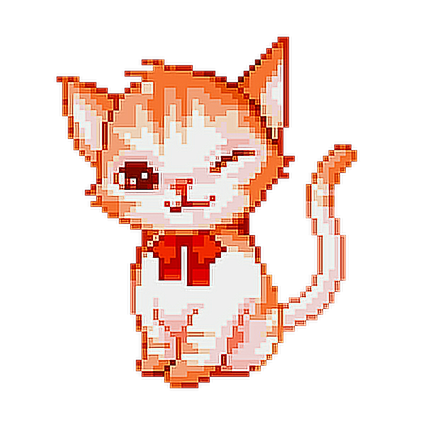

   
    🙏 WAHEGURU JI DA KHALSA WAHEGURU JI DI FATEH 🙏 
   

**<h4 align="center">`Aspiring to solve real world problems and become a Technically Sound Enginner ✨`**

<pre align="center">
    💼 B.E in E.C.E @ UIET,PU 
    •💻  Full stack dev • 🌎 India • 🇮🇳
    🎮 Music • Games • Code • Graphic Designing
    ➡️ When I am not glued to the screen you will 
    probably find me on the volleyball pitch.
</pre>
</h4>

  

* 🌱 I’m currently learning **Full stack development and Machine Learning**
* 🛕 Based out of **United Sectors of Chandigarh**

* 👨‍💻 All of my projects are available at [my portfolio](https://bhogindertechsky.netlify.app)

* 📫 Get in touch: **<bhoginder405@gmail.com>**

* ⚡ Fun fact **2+2 is 4 -1 that's 3, Quick Mafs !**

 

<h3 align="left">Connect with me:</h3>

  

---

### Languages :  

### Frameworks :  

### Design :  

### Other Skills :  

 

##### If you have any questions, suggestions, or just want to say hi, feel free to reach out, I'll be happy to meet you. Peace 

 

